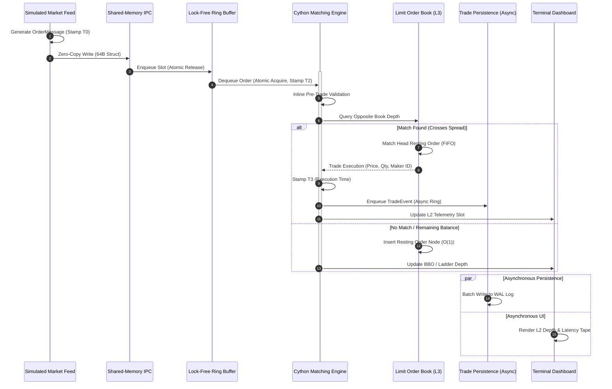

# ChronosMatch System Architecture & Technical Specification

> **Document Status**: Foundation Specification (Phase 1)  
> **Target Audience**: Systems Engineers, Quantitative Researchers, Low-Latency Developers  
> **Classification**: Educational & Research HFT Simulation Engine (Non-Production)

---

## 1. Executive Summary & Design Philosophy

**ChronosMatch** is an in-memory, high-frequency trading (HFT) style simulated order-matching engine designed to explore ultra-low latency, zero-copy inter-process communication (IPC), and deterministic order execution.

### 1.1 Problem Statement

High-frequency trading systems process hundreds of thousands to millions of order events per second with sub-microsecond latency. When implemented in managed runtimes like standard Python or naive multi-threaded C++, systems encounter severe architectural degradation:

- **Heap Allocation Overhead & GC Pauses**: Continuously allocating order objects on the heap triggers garbage collection cycles, inducing devastating tail latency (p99/p99.9) jitter.
- **Serialization Stalls**: Inter-process message exchange over TCP or UNIX domain sockets using standard formats (JSON, Pickle, Protobuf) wastes hundreds of CPU cycles serializing, deserializing, and copying memory frames.
- **Lock Contention & Preemption**: Protecting order book data structures with mutexes or condition variables results in operating system thread preemption, kernel context switching, and cache-line bouncing.
- **CPU Cache Unfriendliness**: Tree-based maps (e.g. red-black trees or nested dictionaries) create pointer-chasing patterns that exhaust CPU L1/L2 caches and incur memory bus stalls.

### 1.2 Core Architectural Principles

ChronosMatch addresses these challenges through **mechanical sympathy**—designing software that harmonizes directly with underlying hardware architecture:

1. **Zero-Copy Ingestion**: Direct memory-mapped buffers (`mmap`) using fixed-size binary structs eliminate memory copies between data generator and matching core.
2. **Cache-Line Alignment**: Core message structs and ring buffer slots are aligned to 64-byte CPU cache lines, eliminating false sharing across processor cores.
3. **Lock-Free Concurrency**: Process boundaries and thread handoffs utilize single-producer single-consumer (SPSC) circular ring buffers governed by atomic acquire/release memory fences.
4. **Deterministic L3 Order Book**: A deterministic Level 3 (L3) limit order book matches orders in strict Price-Time Priority (FIFO), guaranteeing bit-identical replayability.
5. **Decoupled Egress**: Disk persistence and terminal UI rendering operate off the critical path, fed via non-blocking asynchronous egress queues.
6. **Simulated Scope Boundary**: ChronosMatch is strictly an educational and benchmarking simulation harness, not a live production trading system or brokerage gateway.

---

## 2. End-to-End Pipeline Architecture

The order processing lifecycle is divided into seven decoupled stages operating across distinct process and thread domains:

```mermaid
flowchart TD
    subgraph Ingestion Domain [Process 1: Market Simulation]
        A[Simulated Market Feed] -->|Fixed 64B Struct| B[Shared-Memory IPC]
    end

    subgraph Memory Bridge [Inter-Process Memory Segment]
        B -->|mmap Direct View| C[Lock-Free SPSC Ring Buffer]
    end

    subgraph Execution Domain [Process 2: Matching Core]
        C -->|Atomic Dequeue (nogil)| D[Cython Matching Engine]
        D <-->|O(1) Price Lookup & Intrusive Queue| E[Limit Order Book (L3)]
        D -->|Asynchronous Batch Enqueue| F[Trade Persistence Worker]
        D -->|Metrics Ring Buffer| G[Terminal Dashboard Service]
    end

    subgraph Egress Domain [I/O & Observability]
        F -->|Sequential Append-Only Write| H[(Trade WAL Log)]
        G -->|Low-Frequency Poll & Render| I[Terminal Console UI]
    end

    classDef fast fill:#2a4d69,stroke:#4b86b4,stroke-width:2px,color:#fff;
    classDef memory fill:#1b3b22,stroke:#2e7d32,stroke-width:2px,color:#fff;
    classDef io fill:#4a235a,stroke:#8e44ad,stroke-width:2px,color:#fff;

    class A,D,E fast;
    class B,C memory;
    class F,G,H,I io;
```

```text
+---------------------------------------------------------------------------------------------------+
|                                     CHRONOSMATCH PIPELINE                                         |
+---------------------------------------------------------------------------------------------------+
  [1. Simulated Market Feed]
           │
           │  (Emits 64-byte cache-aligned OrderMessage with nanosecond timestamp T0)
           ▼
  [2. Shared-Memory IPC]
           │
           │  (Direct memory-mapped memory region without socket copies or serialization)
           ▼
  [3. Lock-Free Ring Buffer]
           │
           │  (SPSC circular queue with atomic acquire-release fences, pinned to Core A)
           ▼
  [4. Cython Matching Engine]  ◄──────────────────────────►  [5. Limit Order Book (L3)]
           │  (Validation, execution, matching loop nogil)        (Contiguous price ladder,
           │                                                       intrusive FIFO order queues)
           ├─────────────────────────────────────────┐
           │ (Trade Execution Events)                │ (Periodic Telemetry Snapshots)
           ▼                                         ▼
  [6. Trade Persistence]                    [7. Terminal Dashboard]
  (Off-path async worker thread)             (Independent console UI thread/process)
  (Append-only binary WAL log)               (Real-time L2 depth, trade tape, latency)
+---------------------------------------------------------------------------------------------------+
```

---

## 3. Component Deep Dives & Interaction Contracts

### 3.1 Component 1: Simulated Market Feed

- **Primary Responsibility**: Synthesizes realistic, high-throughput order flow without requiring external exchange connectivity.
- **Operational Characteristics**:
  - Emits order operations: `NEW`, `CANCEL`, `MODIFY`, `LIMIT`, and `MARKET`.
  - Configurable arrival patterns: Uniform rate, Poisson distributed arrivals, or microsecond burst clusters.
  - Multi-participant simulation: Generates orders across multiple client identities (`client_id`) with configurable bid/ask skew and spread depth.
- **Hardware Timestamping**: Records high-resolution ingestion timestamp $T_0$ using CPU cycle counters (`rdtsc` on x86_64 or `time.perf_counter_ns()`).
- **Output Interface**: Direct in-place writing of the fixed 64-byte `OrderMessage` struct into the shared-memory queue.

### 3.2 Component 2: Shared-Memory IPC

- **Primary Responsibility**: Provides a zero-copy transport layer between the simulated feed generator and the matching engine process.
- **Mechanism**:
  - Employs operating system memory-mapped files (`mmap`): Win32 Named Shared Memory on Windows, POSIX `shm_open` / `mmap` on Linux.
  - Both processes map the identical physical memory pages into their virtual address spaces.
- **Zero-Copy Guarantee**: No socket buffers, no TCP/IP stack traversal, and no intermediate serialization (e.g. JSON/Pickle). The sender writes binary struct bytes directly to memory; the receiver reads them immediately via raw pointers or Cython typed memory views.

### 3.3 Component 3: Lock-Free Ring Buffer

- **Primary Responsibility**: Decouples the shared-memory reader from the matching engine execution core.
- **Design & Synchronization**:
  - **SPSC Architecture**: Single-Producer Single-Consumer circular queue.
  - **Power-of-Two Sizing**: Buffer size $N = 2^k$ (e.g. $1,048,576$ slots). Slot wrapping uses ultra-fast bitwise masking (`head & (N - 1)`) instead of expensive integer division modulo (`%`).
  - **Atomic Memory Fences**: The producer updates `head` using atomic `memory_order_release`; the consumer loads `head` with `memory_order_acquire`.
  - **Cache Line Separation**: The producer `head` pointer and consumer `tail` pointer reside on separate 64-byte cache lines with padding to prevent cache-line bouncing (false sharing).
  - **Thread Polling & Affinity**: Threads run in busy-wait polling loops with tight CPU core affinity (pinning), eliminating thread sleep and wakeup latency.

### 3.4 Component 4: Cython Matching Engine

- **Primary Responsibility**: Orchestrates order validation, order book mutation, and execution generation on the hot path.
- **Implementation Strategy**:
  - Compiled Cython / C extension module executing with the Python Global Interpreter Lock released (`nogil`).
  - Zero dynamic heap allocation on the matching path: uses pre-allocated memory pools for order nodes.
  - Inline pre-trade risk checks: Validates order boundaries (maximum order quantity, allowable price tick bounds) without external calls.
  - Deterministic state machine: Applies sequenced order messages sequentially, guaranteeing deterministic outputs.

### 3.5 Component 5: Limit Order Book (LOB)

- **Primary Responsibility**: Maintains resting market depth and matches aggressive incoming orders in Price-Time Priority (FIFO).
- **Data Structure Layout**:
  - **Price Ladder Index**: Fixed contiguous array of price ticks for dense prices, supplemented by a sparse index map for sparse price regimes.
  - **Price Levels**: Each price level stores total aggregated volume and count of resting orders.
  - **Intrusive Doubly-Linked Lists**: Orders within each price level are linked via intrusive pointers (`prev`, `next`) embedded directly inside the order node struct.
- **Complexity Guarantees**:
  - $O(1)$ Price Level Lookup (direct tick index arithmetic).
  - $O(1)$ Queue Insertion (append to tail of price level).
  - $O(1)$ Execution / Head Match (pop from head of price level).
  - $O(1)$ Order Cancellation (direct pointer removal from intrusive list via order index map).
- **Matching Semantics**:
  - **Limit Orders**: Match against resting opposite book up to limit price; unfulfilled balance rests in the book.
  - **Market Orders**: Match aggressively across resting depth until filled; any unfilled portion rejected/cancelled if depth exhausted.
  - **Partial Fills**: In-place quantity decrement of resting order node at the head of queue.

### 3.6 Component 6: Trade Persistence & Crash Recovery

- **Primary Responsibility**: Captures an immutable, append-only audit log of all order submissions, cancellations, and trade executions, enabling deterministic state recovery after unexpected process or system termination.
- **Binary WAL Framing & Layout**:
  - **File Header (32 Bytes)**: Magic bytes (`b"CMWL"`), format version (`uint16=1`), header size (`uint16=32`), creation timestamp ($T_0$), and active durability policy code.
  - **Record Frame Header (24 Bytes)**: Record magic (`b"CWAL"`), monotonic Log Sequence Number (`LSN uint64 >= 1`), record type (`uint8: 1=ORDER, 2=CANCEL, 3=TRADE, 4=CHECKPOINT`), flags (`uint8`), payload length (`uint32`), and CRC32 checksum (`uint32`).
  - **Payloads**: Orders (fixed 64-byte `ORDER_STRUCT`), Cancellations (40 bytes), Trades (128-byte dual-cache-line struct with stable IDs and price scaling), and Checkpoints (24 bytes).
- **Durability Policies**:
  - `IMMEDIATE_SYNC`: Synchronously flushes operating system page cache and calls `os.fsync()` on physical disk per record before acknowledging. Highest durability (zero data loss across OS/power crashes), higher latency per write.
  - `FLUSH_ON_WRITE`: Flushes each record to the OS page cache (`file.flush()`) without blocking for disk spindle/SSD sync. Survives application-level crashes; uncommitted dirty pages vulnerable to OS panics or power outages.
  - `ASYNC_BUFFERED`: Decouples persistence from the latency-sensitive matching loop using `AsyncPersistenceWorker`. Writes are queued in memory and batched to disk in the background, keeping matching path latency sub-microsecond.
- **Crash Recovery & Replay Guarantees**:
  - `RecoveryManager`: Replays valid sequenced WAL records through a fresh `MatchingEngine`.
  - **State Reconstructed**: Limit Order Book bids, asks, price levels, and FIFO queue order priority; in-memory trade history and trade counter.
  - **Duplicate Replay Protection**: Existing persisted trades are deduplicated against replayed executions, preventing silent duplicate trade emission.
  - **Truncated & Corrupt Record Resilience**: Detects incomplete trailing records from mid-write crashes, reporting diagnostic warnings and safely truncating corrupted trailing bytes via `repair_wal()`. Payload bit-flips are trapped via CRC32 validation.
- **Trade Persistence**:
  - `TradeStore`: Dedicated storage repository indexing trades by stable identifier and participating order IDs, providing historical queries and aggregated volume telemetry.

### 3.7 Component 7: Terminal Dashboard

- **Primary Responsibility**: Provides real-time visual observability into engine operations, market depth, and performance metrics.
- **Decoupled Telemetry**:
  - The matching core updates a compact shared-memory telemetry block (or low-frequency metrics ring buffer) at fixed microsecond intervals.
  - The dashboard runs as an independent console UI process/thread (using Rich/Textual/curses).
- **Console Interface Elements**:
  - **Level 2 (L2) Depth Ladder**: Top 10 Bids and Top 10 Asks, with visual depth bars and Best Bid/Offer (BBO) spread.
  - **Real-Time Trade Tape**: Scrolling stream of recent executions (timestamp, price, quantity, aggressive side).
  - **Throughput Telemetry**: Orders processed per second, peak burst throughput.
  - **Latency Distribution**: Real-time display of $T_{\text{tick-to-trade}}$ percentiles (p50, p90, p99, p99.9).

---

## 4. Data Structures & Memory Layouts

To eliminate serialization and avoid false sharing, all critical path messages are designed to fit precisely within a single 64-byte CPU cache line:

### 4.1 Fixed-Size 64-Byte `OrderMessage` Layout

```text
 0                   1                   2                   3
 0 1 2 3 4 5 6 7 8 9 0 1 2 3 4 5 6 7 8 9 0 1 2 3 4 5 6 7 8 9 0 1
+-+-+-+-+-+-+-+-+-+-+-+-+-+-+-+-+-+-+-+-+-+-+-+-+-+-+-+-+-+-+-+-+
|                      timestamp_ns (uint64)                    |  8 Bytes
|                                                               |
+-+-+-+-+-+-+-+-+-+-+-+-+-+-+-+-+-+-+-+-+-+-+-+-+-+-+-+-+-+-+-+-+
|                        order_id (uint64)                      |  8 Bytes
|                                                               |
+-+-+-+-+-+-+-+-+-+-+-+-+-+-+-+-+-+-+-+-+-+-+-+-+-+-+-+-+-+-+-+-+
|                       client_id (uint32)      |sym_id (uint32)|  8 Bytes
+-+-+-+-+-+-+-+-+-+-+-+-+-+-+-+-+-+-+-+-+-+-+-+-+-+-+-+-+-+-+-+-+
|                      price_ticks (int64)                      |  8 Bytes
|                                                               |
+-+-+-+-+-+-+-+-+-+-+-+-+-+-+-+-+-+-+-+-+-+-+-+-+-+-+-+-+-+-+-+-+
|                          qty (uint32)         | action | side |  6 Bytes
+-+-+-+-+-+-+-+-+-+-+-+-+-+-+-+-+-+-+-+-+-+-+-+-+-+-+-+-+-+-+-+-+
|  type | flags |                  reserved (22 Bytes)          |  26 Bytes
|               |                                               |
+-+-+-+-+-+-+-+-+-+-+-+-+-+-+-+-+-+-+-+-+-+-+-+-+-+-+-+-+-+-+-+-+
Total: Exactly 64 Bytes (Aligned to 1 CPU Cache Line)
```

#### Field Specifications

| Field | Type | Offset | Size | Description |
| :--- | :--- | :--- | :--- | :--- |
| `timestamp_ns` | `uint64_t` | 0 | 8 B | Hardware nanosecond timestamp at generation ($T_0$). |
| `order_id` | `uint64_t` | 8 | 8 B | Monotonically increasing unique order identifier. |
| `client_id` | `uint32_t` | 16 | 4 B | Identifier of the originating participant. |
| `symbol_id` | `uint32_t` | 20 | 4 B | Instrument/ticker identifier (integer-mapped). |
| `price_ticks` | `int64_t` | 24 | 8 B | Fixed-point limit price represented in integer ticks. |
| `qty` | `uint32_t` | 32 | 4 B | Order quantity in contract/share units. |
| `action` | `uint8_t` | 36 | 1 B | Action type: `1 = NEW`, `2 = CANCEL`, `3 = MODIFY`. |
| `side` | `uint8_t` | 37 | 1 B | Order side: `1 = BUY (Bid)`, `2 = SELL (Ask)`. |
| `order_type` | `uint8_t` | 38 | 1 B | Type: `1 = LIMIT`, `2 = MARKET`. |
| `flags` | `uint8_t` | 39 | 1 B | Bitflags (e.g., Immediate-or-Cancel, Fill-or-Kill). |
| `reserved` | `uint8_t[24]` | 40 | 24 B | Cache padding and future extensibility. |

### 4.2 64-Byte `TradeEvent` Layout

Execution fills emitted by the matching engine follow a matching 64-byte layout:

| Field | Type | Size | Description |
| :--- | :--- | :--- | :--- |
| `exec_timestamp_ns` | `uint64_t` | 8 B | Matching engine execution timestamp ($T_3$). |
| `trade_id` | `uint64_t` | 8 B | Unique trade sequence number. |
| `maker_order_id` | `uint64_t` | 8 B | Resting order ID. |
| `taker_order_id` | `uint64_t` | 8 B | Aggressive order ID. |
| `execution_price` | `int64_t` | 8 B | Traded price in fixed-point ticks. |
| `execution_qty` | `uint32_t` | 4 B | Traded quantity. |
| `symbol_id` | `uint32_t` | 4 B | Instrument identifier. |
| `aggressive_side` | `uint8_t` | 1 B | `1 = BUY`, `2 = SELL`. |
| `is_full_fill` | `uint8_t` | 1 B | `1 = maker order fully consumed`, `0 = partial`. |
| `reserved` | `uint8_t[14]` | 14 B | Cache padding to reach exactly 64 bytes. |

---

## 5. Execution Sequence & Event Flow

The sequence diagram below traces an incoming order through every stage of ChronosMatch:



---

## 6. Concurrency & Memory Synchronization Model

To eliminate operating system scheduling latency, ChronosMatch adheres to a strict concurrency contract:

1. **Thread Core Affinity (Pinning)**:
   - Ingestion thread pinned to CPU Core $k$.
   - Matching engine thread pinned to CPU Core $k+1$.
   - Persistence and Dashboard threads assigned to background cores.
   - Eliminates CPU migration cache invalidation.
2. **Lock-Free SPSC Memory Ordering**:
   ```c
   // Producer (Feed Writer):
   buffer[head & mask] = order_message;
   atomic_store_explicit(&producer_head, head + 1, memory_order_release);

   // Consumer (Matching Core):
   size_t head = atomic_load_explicit(&producer_head, memory_order_acquire);
   if (tail < head) {
       OrderMessage msg = buffer[tail & mask];
       atomic_store_explicit(&consumer_tail, tail + 1, memory_order_release);
       process_order(msg);
   }
   ```
3. **No Dynamic Memory Allocation on Hot Path**:
   - Order nodes are allocated from a pre-allocated fixed memory pool created at engine startup.
   - Memory reuse via free-list pointers avoids invoking `malloc`/`free` or Python heap allocators during live matching.

---

## 7. Performance Measurement & Profiling Methodology

Accurate benchmarking in HFT requires microsecond and nanosecond granularity without introducing measurement overhead:

### 7.1 Latency Checkpoints & Decomposition

| Metric | Formula | Target Threshold | Description |
| :--- | :--- | :--- | :--- |
| **Ingestion Transit** | $T_1 - T_0$ | $< 500\text{ ns}$ | Time to write and detect order in shared memory. |
| **Queue Dwell** | $T_2 - T_1$ | $< 800\text{ ns}$ | Duration spent traversing the lock-free ring buffer. |
| **Pure Match Duration** | $T_3 - T_2$ | $< 1.5\text{ }\mu\text{s}$ | Order book lookup, price level traversal, and execution. |
| **Total Tick-to-Trade** | $T_3 - T_0$ | $< 3.0\text{ }\mu\text{s}$ | End-to-end latency from synthetic generation to trade fill. |

### 7.2 Percentile Reporting vs Mean

Mean latency is explicitly avoided because it obscures latency spikes. Telemetry profiles record:
- **p50 (Median)**: Baseline processing latency under normal load.
- **p90 / p99**: Performance under microburst conditions and moderate queue depth.
- **p99.9**: Worst-case tail latency caused by memory bus contention or cache misses.
- **Max Jitter**: Absolute highest recorded latency observed in a run.

### 7.3 Auditing Heap Allocations

During automated performance testing, the engine will be audited using Python's `tracemalloc` and Cython memory profiling to ensure exactly **0 heap allocations** occur inside the matching loop.

---

## 8. Technology Stack & Repository Mapping

The repository structure matches the architectural layers:

| Layer | Technology | Actual Repository Path |
| :--- | :--- | :--- |
| **Project Packaging** | Python 3.12, PEP 621, Setuptools | [pyproject.toml](file:///c:/Users/keert/OneDrive/Desktop/Chronosmatch-project1/Chronos-match/pyproject.toml) |
| **Package Initialization** | Python 3.12 | [src/chronosmatch/__init__.py](file:///c:/Users/keert/OneDrive/Desktop/Chronosmatch-project1/Chronos-match/src/chronosmatch/__init__.py) |
| **Order Data Models** | Dataclasses, validation | [src/chronosmatch/models.py](file:///c:/Users/keert/OneDrive/Desktop/Chronosmatch-project1/Chronos-match/src/chronosmatch/models.py) |
| **Binary Protocol** | 64-byte struct cache-aligned | [src/chronosmatch/binary_protocol.py](file:///c:/Users/keert/OneDrive/Desktop/Chronosmatch-project1/Chronos-match/src/chronosmatch/binary_protocol.py) |
| **Shared-Memory IPC** | Win32 / POSIX mmap | [src/chronosmatch/shared_memory.py](file:///c:/Users/keert/OneDrive/Desktop/Chronosmatch-project1/Chronos-match/src/chronosmatch/shared_memory.py) |
| **Lock-Free Ring Buffer** | SPSC circular buffer | [src/chronosmatch/ring_buffer.py](file:///c:/Users/keert/OneDrive/Desktop/Chronosmatch-project1/Chronos-match/src/chronosmatch/ring_buffer.py) |
| **Producer-Consumer IPC** | Cross-process workers | [src/chronosmatch/producer_consumer.py](file:///c:/Users/keert/OneDrive/Desktop/Chronosmatch-project1/Chronos-match/src/chronosmatch/producer_consumer.py) |
| **LOB & Price Ladder** | Deterministic L3 book | [src/chronosmatch/order_book.py](file:///c:/Users/keert/OneDrive/Desktop/Chronosmatch-project1/Chronos-match/src/chronosmatch/order_book.py) |
| **Matching Engine Core** | FIFO Price-Time Priority | [src/chronosmatch/matching_engine.py](file:///c:/Users/keert/OneDrive/Desktop/Chronosmatch-project1/Chronos-match/src/chronosmatch/matching_engine.py) |
| **Cython Acceleration Layer** | Optional C extension | [src/chronosmatch/cython_engine.py](file:///c:/Users/keert/OneDrive/Desktop/Chronosmatch-project1/Chronos-match/src/chronosmatch/cython_engine.py) |
| **Synthetic Market Simulator** | Async Poisson / burst feed | [src/chronosmatch/market_simulator.py](file:///c:/Users/keert/OneDrive/Desktop/Chronosmatch-project1/Chronos-match/src/chronosmatch/market_simulator.py) |
| **End-to-End Trading Pipeline** | Integrated orchestration | [src/chronosmatch/pipeline.py](file:///c:/Users/keert/OneDrive/Desktop/Chronosmatch-project1/Chronos-match/src/chronosmatch/pipeline.py) |
| **Trade-Event Persistence & WAL** | Append-only binary WAL, TradeStore, Crash Recovery | [src/chronosmatch/persistence.py](file:///c:/Users/keert/OneDrive/Desktop/Chronosmatch-project1/Chronos-match/src/chronosmatch/persistence.py) |
| **Planned Dashboard UI** | Rich / Textual Terminal UI | `src/chronosmatch/dashboard/` *(Planned Next Phase)* |

---

## 9. Implementation Status & Phase Roadmap

Below is the definitive status breakdown distinguishing currently implemented components from upcoming phases:

```text
Phase 1: Foundation & Packaging                  [COMPLETED]
Phase 2: Binary Protocol & Shared-Memory IPC     [COMPLETED]
Phase 3: Lock-Free SPSC Ring Buffer              [COMPLETED]
Phase 4: Limit Order Book & Matching Engine Core [COMPLETED]
Phase 5: Market Simulator & Pipeline Integration [COMPLETED]
Phase 6: WAL Persistence & Crash Recovery        [COMPLETED]
Phase 7: Terminal Dashboard & Telemetry UI       [PLANNED]
```

### Phase Breakdown

| Phase | Milestone | Deliverables | Current Status |
| :---: | :--- | :--- | :---: |
| **1** | **Foundation Setup** | PEP 621 packaging, automated pytest test suite, `.env.example`, architectural specification. | **COMPLETED** |
| **2** | **IPC & Message Schemas** | 64-byte `ORDER_STRUCT` cache-aligned binary protocol, cross-platform shared-memory driver (`mmap`). | **COMPLETED** |
| **3** | **Lock-Free Ring Buffer** | SPSC ring buffer with memory fences, power-of-two bitmasking, bounded blocking & non-blocking put/get. | **COMPLETED** |
| **4** | **LOB & Matching Core** | L3 price-time priority order book, intrusive queue, Python baseline + optional Cython extension. | **COMPLETED** |
| **5** | **Feed & Pipeline Integration**| Bursty Poisson market simulator, backpressure handling, end-to-end `TradingPipeline` integration. | **COMPLETED** |
| **6** | **Trade WAL Persistence** | Off-path append-only WAL logging, deterministic replay harness, and crash recovery. | **COMPLETED** |
| **7** | **Dashboard & Telemetry** | Real-time Rich/Textual terminal UI, nanosecond latency histogram, live depth book visualization. | *Planned* |

---

## 10. System Limitations & Scope Boundaries

ChronosMatch explicitly delineates what it is and what it is not:

1. **Non-Production Simulation**:
   - ChronosMatch does not interface with live exchange APIs (e.g., NASDAQ ITCH/OUCH, CME MDP 3.0/iLink, FIX 4.2/4.4/5.0).
   - It is not designed to execute live financial capital or interface with broker-dealer routing networks.
2. **Single-Node Shared-Memory Topology**:
   - IPC is optimized for low-latency multi-core communication within a single host via shared RAM.
   - It does not implement distributed consensus, network replication, or multi-node clustering.
3. **Platform Differences**:
   - Low-latency memory primitives differ between Windows (Win32 Named Shared Memory, `SetThreadAffinityMask`) and Linux (POSIX `shm_open`, `mmap`, `sched_setaffinity`). Production HFT typically runs on Linux bare-metal with kernel bypass (Solarflare OpenOnload).
4. **Scope of Financial Order Types**:
   - Initial implementation strictly supports standard Limit Orders and Market Orders under Price-Time Priority.
   - Complex conditional order types (Stop-Loss, Trailing Stop, Iceberg, Pegged) and regulatory consolidated audit trail (CAT) rules are deliberately excluded.
